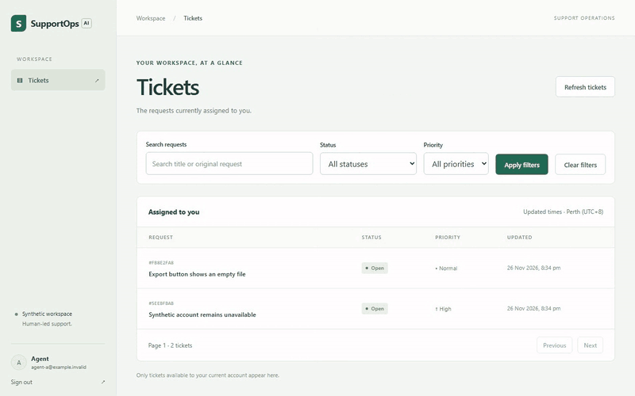
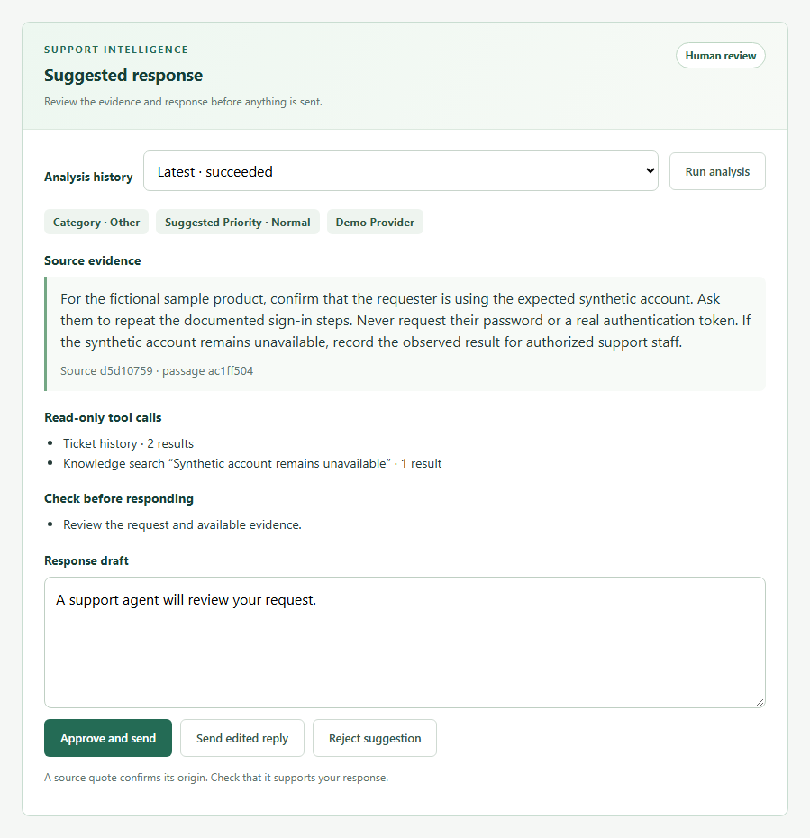
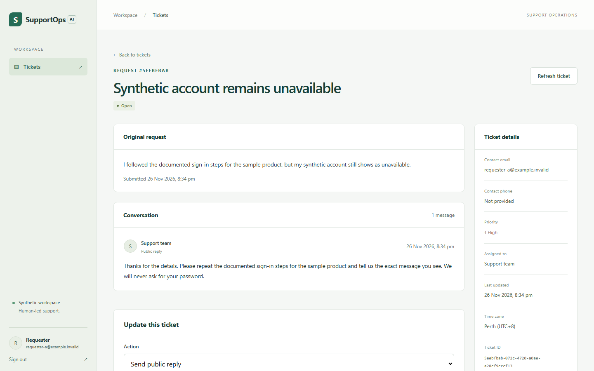
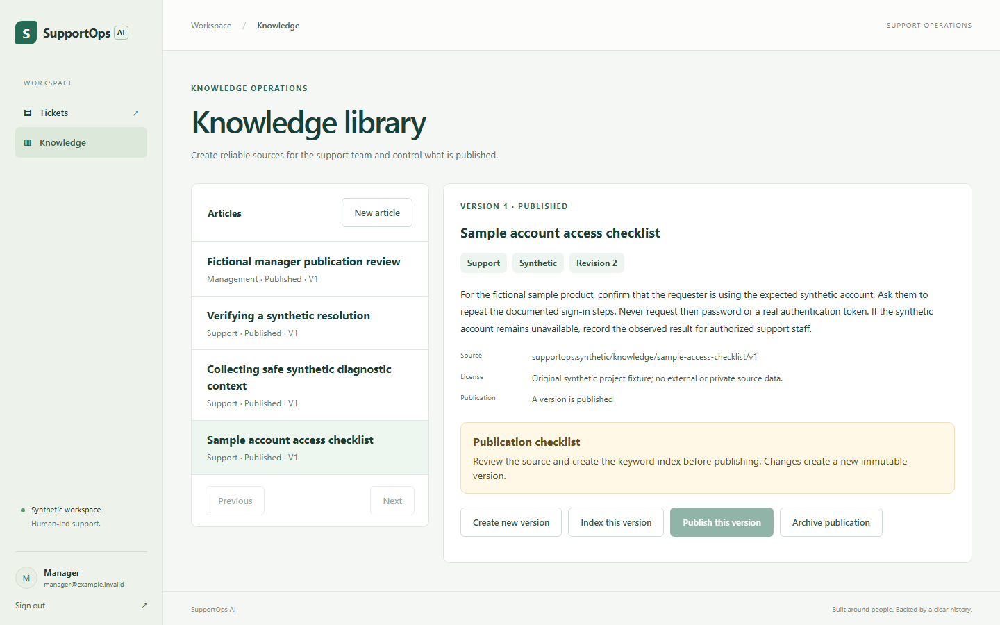
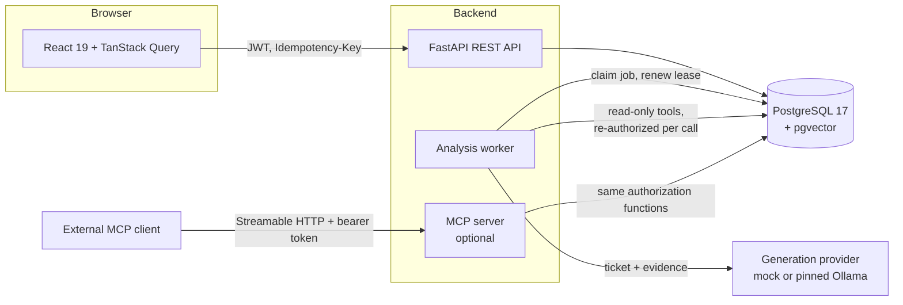
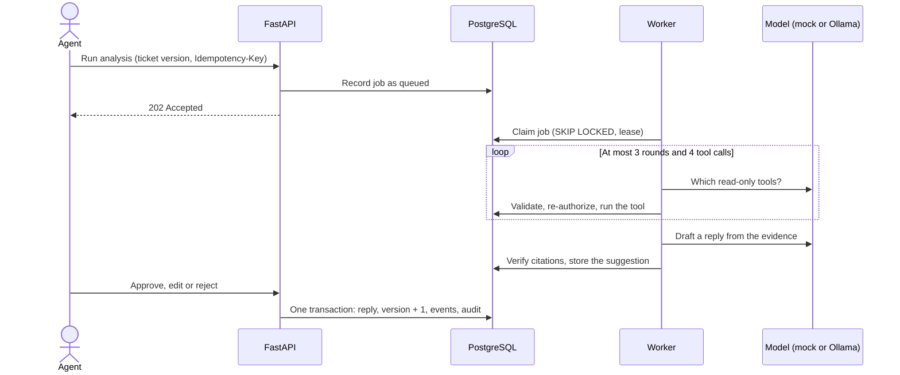
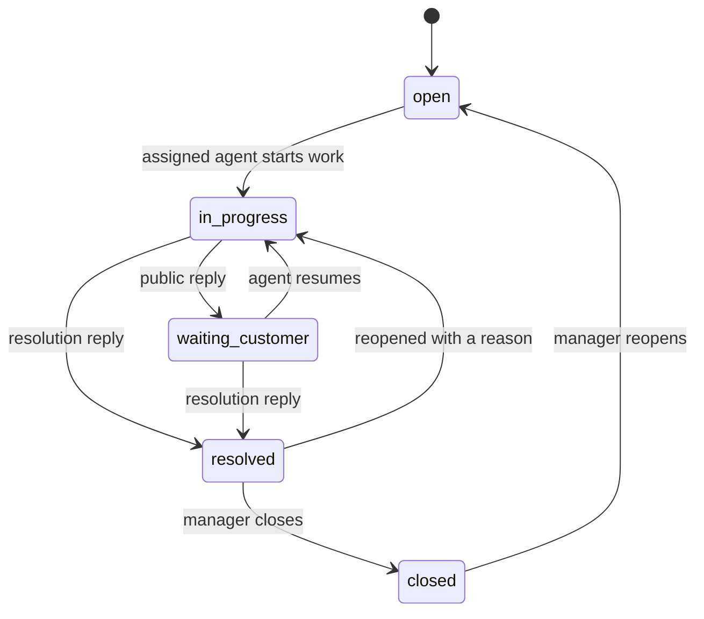

<div align="center">

# SupportOps AI

**An AI-assisted help desk where the model drafts, the server decides, and a person sends.**

[](README.md)
[](README.zh-CN.md)

[](https://github.com/Maxwell2048/supportops-ai/actions/workflows/ci.yml) [](LICENSE)      

[Demo](#see-it-in-action) · [Features](#features) · [How it works](#how-it-works) · [Quick start](#quick-start) · [Documentation](#documentation) · [FAQ](#faq)

</div>


SupportOps AI is a full-stack ticket and knowledge platform for a fictional software support team. Customers open tickets, agents work the ones assigned to them, and managers run the team and curate a versioned knowledge base. When an agent asks for help, a background worker lets a language model look things up through read-only tools and draft a reply that quotes its sources. **Nothing reaches the customer until a staff member approves, edits or rejects the draft.**

> [!NOTE]
> This is a portfolio project. It uses synthetic data only and runs locally with Docker Compose. The default model is a deterministic mock; a pinned local Ollama model is optional. Cloud deployment has not started. See the [roadmap](#roadmap) for what is verified.

<details>
<summary><b>Table of contents</b></summary>

- [See it in action](#see-it-in-action)
- [Why this project](#why-this-project)
- [Highlights](#highlights)
- [Features](#features)
- [Screenshots](#screenshots)
- [How it works](#how-it-works)
- [By the numbers](#by-the-numbers)
- [Quick start](#quick-start)
- [Configuration](#configuration)
- [API at a glance](#api-at-a-glance)
- [Connect an MCP client](#connect-an-mcp-client)
- [Testing](#testing)
- [Tech stack](#tech-stack)
- [Project structure](#project-structure)
- [Documentation](#documentation)
- [Roadmap](#roadmap)
- [FAQ](#faq)
- [Contributing](#contributing)
- [License](#license)

</details>

## See it in action

An agent opens an assigned ticket, runs the analysis, checks the quoted evidence and the tool calls, rewrites the draft, and sends it. The reply then appears in the conversation.



<sub>Recorded from a local stack with synthetic data and the default mock provider, so the original draft text is a fixed placeholder.</sub>

## Why this project

AI features in support tools fail in predictable ways. The model invents a source, reads another customer's ticket, or sends a reply nobody checked. SupportOps AI is built around one rule that addresses all three: **the model only proposes; the server decides; a person sends.**

| Risk | What SupportOps AI does |
|---|---|
| Invented sources | Every citation must be an exact, contiguous quote from published knowledge the agent may read. A draft without evidence can only be rejected. |
| Data leaking across customers | Tool calls go through the same role and object checks as the REST API, re-checked on every call. |
| Unchecked replies | A person approves, edits or rejects. Approval posts the reply, bumps the ticket version and writes events and audit records in one transaction. |

## Highlights

<table>
<tr>
<td width="33%" valign="top">

**🔎 Grounded drafts**<br>
Quotes are checked against stored knowledge chunks when the draft is saved, read and sent.

</td>
<td width="33%" valign="top">

**🛡️ Server-side control**<br>
An allow-list, strict arguments and a 3-round, 4-call budget bound the model's tool use.

</td>
<td width="33%" valign="top">

**🧑‍💼 Human in the loop**<br>
Approve, edit or reject; review requests are idempotent and safe to retry.

</td>
</tr>
<tr>
<td valign="top">

**📚 Versioned knowledge**<br>
Immutable versions, a publication pointer and permission-aware keyword and vector search.

</td>
<td valign="top">

**🔌 MCP server**<br>
External MCP clients read tickets and knowledge with the API's own authorization and an audit row per call.

</td>
<td valign="top">

**🧪 Verified, not just built**<br>
421 backend, 53 frontend and 24 end-to-end tests run in CI, with dated evidence for every claim.

</td>
</tr>
</table>

## Features

### Ticket workflow for three roles

| Requester | Agent | Manager |
|---|---|---|
| Create tickets with an optional contact phone | See only the tickets assigned to them | See and filter every ticket |
| Follow public replies on their own tickets | Reply publicly or add internal notes | Assign agents; change status, priority and archive state |
| Reopen a resolved ticket with a reason | Run AI analysis and review drafts | Curate the knowledge base and query the audit trail |

Every write carries an `Idempotency-Key` and the ticket version it was based on. Retries after a lost response return the original result. Two people editing the same ticket get a `409` conflict, and their draft is kept for review.

### AI drafts you can audit

- **Read-only tool loop.** The model may call `search_knowledge` and `ticket_history`. The server checks each call against an allow-list and strict arguments, then re-authorizes the agent and the ticket before running it. Reviewers see every call. ([tool use](docs/agent-tools.md))
- **Citation checks.** Quotes are verified against the stored knowledge chunk, and verified again when the draft is read and when it is sent. ([citations](docs/citations.md))
- **Human review.** Approve, send an edited reply, or reject. ([review](docs/review.md))
- **Provider provenance.** Each draft records the provider and model that produced it. A local Ollama model can be pinned by digest. ([generation](docs/generation.md))
- **Optional LangGraph orchestration** of the same loop, behind the same server-side checks. ([LangGraph](docs/langgraph-tool-loop.md))

### Versioned knowledge base

Managers write drafts, index them, then publish or archive. Published versions are immutable; publishing moves a pointer, so old citations always resolve to the exact text they quoted. Retrieval filters by the reader's permissions before ranking. ([knowledge](docs/knowledge.md), [retrieval](docs/retrieval.md))

### Read-only MCP server

External MCP clients such as Claude Code can list and read the caller's tickets, public ticket history and permitted knowledge. The server reuses the API's JWT validation and authorization functions and writes one audit row per call. It is a separate process and is off by default. ([MCP](docs/mcp.md))

### Engineering details

- **Authorization in SQL.** Ticket queries start from a role-scoped base query. Objects outside the caller's scope return `404`, so their existence is not revealed. ([permissions](docs/permissions.md))
- **Durable job queue in PostgreSQL.** Workers claim jobs with `FOR UPDATE SKIP LOCKED`, hold a renewable lease and retry transient failures. ([jobs](docs/jobs.md))
- **Transactional audit.** Successful writes and their audit rows commit together; every response carries a request ID. ([audit](docs/audit.md))
- **Session-scoped frontend cache.** TanStack Query keys include the session and role, so one user never sees another user's cached data. ([query cache](docs/query-cache.md))

## Screenshots

<table>
<tr>
<td width="50%"><br><sub><b>Agent:</b> the suggested response with its quoted source, tool calls and review actions</sub></td>
<td width="50%"><br><sub><b>Requester:</b> the sent reply appears as a public message; internal notes and drafts stay hidden</sub></td>
</tr>
<tr>
<td width="50%"><br><sub><b>Manager:</b> the knowledge library with versions, scope, source and publication actions</sub></td>
<td width="50%"><br><sub><b>Manager:</b> every ticket with search, status and priority filters</sub></td>
</tr>
</table>

## How it works

### Architecture



### From "Run analysis" to a sent reply



### Ticket lifecycle



Unlisted transitions return `409 invalid_transition`. Managers can archive closed tickets. See [state transitions](docs/state-transitions.md).

## By the numbers

| Item | Count |
|---|---|
| Roles with separate views and permissions | 3 |
| Database tables / Alembic migrations | 15 / 11 |
| Architecture decision records | 12 |
| Backend tests (PostgreSQL, no skips) | 421 |
| Frontend unit and component tests | 53 |
| Playwright end-to-end tests (desktop and narrow viewports) | 24 |
| Read-only MCP tools | 4 |

Test counts come from the latest CI run on `main`.

## Quick start

**Prerequisites:** Git, Docker Desktop (or Docker Engine with Compose v2) and PowerShell 7. On macOS or Linux, use the equivalent shell commands.

```powershell
git clone https://github.com/Maxwell2048/supportops-ai.git
cd supportops-ai
Copy-Item .env.example .env
```

Edit `.env` and set `POSTGRES_PASSWORD` and `JWT_SECRET` (a random value of at least 32 bytes). Then start the stack, which contains PostgreSQL, migrations, the API, the mock worker and the web app:

```powershell
docker compose -f compose.full.yaml up --build -d --wait
```

Activate the five synthetic demo accounts with a password of your choice (12 or more characters):

```powershell
$env:DEMO_PASSWORD = Read-Host 'Demo password'
docker compose -f compose.full.yaml exec -T -e DEMO_PASSWORD api python -m supportops.compose_demo
```

Open <http://127.0.0.1:8080> and sign in with that password:

| Account | Role |
|---|---|
| `requester-a@example.invalid`, `requester-b@example.invalid` | Requester |
| `agent-a@example.invalid`, `agent-b@example.invalid` | Agent |
| `manager@example.invalid` | Manager |

**Try the AI flow**

1. As the manager, open **Knowledge**, create an article, then index and publish it.
2. Assign a ticket to `agent-a`.
3. Sign in as `agent-a`, open the ticket and click **Run analysis**. When the ticket title matches the article's words, the draft cites it.
4. Approve, edit or reject the draft, then sign in as the requester to see the reply.

Stop the stack with `docker compose -f compose.full.yaml down`; the database volume is kept. Backup, restore and port settings are in the [Compose guide](docs/compose.md).

<details>
<summary><b>Manual development setup (hot reload)</b></summary>

Requires Python 3.14 with [uv](https://docs.astral.sh/uv/) and Node 22. Create `.env` from `.env.example` and set `POSTGRES_PASSWORD`. Start only the database container, then run each service from its own terminal.

```powershell
docker compose up -d db

# backend/
uv sync --locked
uv run --locked alembic upgrade head
uv run --locked python ../scripts/seed.py
uv run --locked python ../scripts/configure_local_auth.py   # adds JWT_SECRET and DEMO_PASSWORD to .env if missing
uv run --locked python ../scripts/activate_demo_accounts.py
uv run --locked uvicorn supportops.main:app --app-dir src --host 127.0.0.1 --port 8000

# backend/ (second terminal): the analysis worker
$env:PYTHONPATH = 'src'
uv run --locked python -m supportops.job_worker

# frontend/
npm ci
npm run dev
```

Vite serves the app on <http://127.0.0.1:5173> and proxies `/api` to port 8000. API docs are at <http://127.0.0.1:8000/docs>. Optional: import the bundled synthetic knowledge with `uv run --locked python ../scripts/seed_knowledge.py --publish`.

Details: [database](docs/database.md), [authentication](docs/auth.md), [frontend](docs/frontend.md), [worker and local models](docs/jobs.md). On Windows, `scripts/start-docker.ps1` starts Docker Desktop if the engine is not running.

</details>

## Configuration

Settings live in `.env` (copied from [`.env.example`](.env.example), never committed).

| Variable | Purpose | Default |
|---|---|---|
| `POSTGRES_DB`, `POSTGRES_USER`, `POSTGRES_PASSWORD` | Database name and credentials | `supportops` / `supportops` / required |
| `POSTGRES_HOST`, `POSTGRES_PORT` | Database address for local runs | `127.0.0.1`, `5432` |
| `JWT_SECRET` | Token signing secret, at least 32 bytes; empty disables login | required |
| `JWT_ISSUER`, `JWT_AUDIENCE` | Token issuer and audience checks | `supportops-api`, `supportops-web` |
| `ACCESS_TOKEN_MINUTES` | Access token lifetime, 1 to 30 minutes | `15` |
| `DEMO_PASSWORD` | Password used when activating synthetic accounts | none |
| `AI_PROVIDER` | Generation provider | `mock` |
| `EMBEDDING_URL` | Local Ollama endpoint for vector embeddings | `http://127.0.0.1:11434` |
| `ANALYSIS_LOOP` | Tool-loop orchestration: `handwritten` or `langgraph` | `handwritten` |
| `SUPPORTOPS_WEB_PORT` | Host port of the Compose web app | `8080` |

## API at a glance

The full contract is in [docs/api.md](docs/api.md) and the interactive OpenAPI page at `/docs`.

| Method and path | Purpose |
|---|---|
| `POST /api/auth/login` · `GET /api/me` | Sign in and read the current identity |
| `GET /api/tickets` · `POST /api/tickets` | List (scoped, filtered, cursor-paginated) and create tickets |
| `GET /api/tickets/{id}` · `PATCH /api/tickets/{id}` | Read and change a ticket (status, assignee, priority, archive) |
| `POST /api/tickets/{id}/messages` | Public reply or internal note |
| `POST /api/tickets/{id}/analysis-jobs` | Start an AI analysis job |
| `GET /api/analysis-jobs/{id}/suggestion` | Read the suggestion, evidence and tool calls |
| `POST /api/suggestions/{id}/review` | Approve, edit or reject a suggestion |
| `GET /api/knowledge/search` | Permission-aware keyword or vector search |
| `POST /api/knowledge/articles/{id}/publish` | Publish a knowledge version |
| `GET /api/audit-events` | Manager audit query |
| `GET /health` · `GET /ready` | Liveness and readiness (database, migration, auth config) |

## Connect an MCP client

Run the MCP server as its own process, then point a client at it with a short-lived access token from `POST /api/auth/login`:

```powershell
# backend/
uv run --locked uvicorn supportops.mcp_server:create_mcp_app --factory --app-dir src --host 127.0.0.1 --port 8001
```

```json
{
  "mcpServers": {
    "supportops": {
      "type": "http",
      "url": "http://127.0.0.1:8001/mcp",
      "headers": { "Authorization": "Bearer ${SUPPORTOPS_ACCESS_TOKEN}" }
    }
  }
}
```

Tools: `list_my_tickets`, `get_ticket`, `ticket_history` and `search_knowledge`, for agents and managers only. This configuration has not yet been tried with a real Claude client; see the [MCP guide](docs/mcp.md).

## Testing

```powershell
# backend/ (uses a dedicated PostgreSQL test database; see docs/database.md)
uv run --locked python ../scripts/test_backend.py -q

# frontend/
npm run build
npm run test:api; npm run test:query; npm run test:writes; npm run test:components; npm run test:types
npm run test:e2e
```

GitHub Actions runs three jobs on every push and pull request:

| Job | What it checks |
|---|---|
| `api` | The backend suite against PostgreSQL with pgvector |
| `web` | Type check and build, unit and component tests, Playwright end-to-end tests |
| `stack` | The full Compose stack, a scripted business flow, then backup and restore with per-table fingerprints |

See the [testing guide](docs/testing.md).

## Tech stack

| Layer | Technology |
|---|---|
| Frontend | React 19, TypeScript 7, Vite 8, TanStack Query 5 |
| Backend | Python 3.14, FastAPI, SQLAlchemy 2.1, Alembic, Pydantic, PyJWT, Argon2 |
| Data | PostgreSQL 17, pgvector, full-text search |
| AI | Provider interface with a deterministic mock and pinned Ollama models; optional LangGraph; MCP Python SDK |
| Testing | pytest, Node test runner, Vitest, Testing Library, Playwright |
| Delivery | Docker Compose, Nginx, GitHub Actions, uv and npm lockfiles |

## Project structure

```text
supportops-ai/
├── backend/
│   ├── src/supportops/     # API routes, services, worker, tool loop, MCP server
│   ├── migrations/         # Alembic migrations 0001–0011
│   └── tests/              # unit and PostgreSQL integration tests
├── frontend/
│   ├── src/                # React pages, components, API client, query state
│   └── tests/              # API-client, query and write tests; component tests
├── data/                   # synthetic seed knowledge
├── evals/                  # retrieval evaluation cases
├── scripts/                # setup, verification, backup and test helpers
├── docs/                   # guides, ADRs and dated verification evidence
├── compose.yaml            # database only, for development
└── compose.full.yaml       # full local stack
```

## Documentation

| Topic | Guides |
|---|---|
| Product and design | [Project brief](docs/planning/project-brief.md) · [Architecture](docs/architecture.md) · [Permissions](docs/permissions.md) · [State transitions](docs/state-transitions.md) · [Data model](docs/data-model.md) · [API contract](docs/api.md) |
| Tickets and security | [Authentication](docs/auth.md) · [Tickets, idempotency and pagination](docs/tickets.md) · [Audit](docs/audit.md) · [Forms and safe retries](docs/forms.md) |
| Knowledge and AI | [Knowledge](docs/knowledge.md) · [Retrieval](docs/retrieval.md) · [Generation](docs/generation.md) · [Jobs](docs/jobs.md) · [Tool use](docs/agent-tools.md) · [Citations](docs/citations.md) · [Review](docs/review.md) · [LangGraph](docs/langgraph-tool-loop.md) · [MCP](docs/mcp.md) |
| Frontend | [Frontend](docs/frontend.md) · [Query cache](docs/query-cache.md) |
| Operations and quality | [Database](docs/database.md) · [Compose and recovery](docs/compose.md) · [Testing](docs/testing.md) · [Delivery handbook](docs/handbook.md) |
| Decisions and history | [Architecture decision records](docs/adr/) · [Progress and evidence](docs/progress.md) · [Git workflow](docs/git-workflow.md) |

## Roadmap

| Milestone | Scope | Status |
|---|---|---|
| M0 | Roles, states, data model, API and data policy | ✅ Drafted |
| M1 | Database, authentication, ticket API, audit | ✅ Verified locally |
| M2 | React app, caching, forms, component and end-to-end tests | ✅ Verified locally and in CI |
| M3 | Knowledge versions, retrieval, AI jobs, citations, human review, tool use, MCP | ✅ Verified with the mock provider; 🔶 real-model evaluation is limited |
| M4 | SQL and AI evaluation, Compose, backup and restore, CI | ✅ Compose, restore and CI; 🔶 broader evaluation open |
| M5 | Azure, infrastructure as code, observability, release rollback | ⏸️ Deferred |

"Implemented" and "verified" are tracked separately; every verified claim links to a dated evidence record in [progress](docs/progress.md).

**Known limits:** keyword retrieval needs every query term to match; real models were only smoke-tested; the knowledge base has four synthetic articles; the MCP server is local-only; on narrow phone screens the ticket table is wider than the viewport.

## FAQ

<details>
<summary><b>Can the AI send a reply or close a ticket by itself?</b></summary>

No. The worker can only store a suggestion. A staff member must approve, edit or reject it, and only approval or an edited send creates a public message. No AI path changes ticket status.

</details>

<details>
<summary><b>Do I need a GPU or an API key?</b></summary>

No. The default provider is a deterministic mock, so the whole flow runs on any machine with Docker. A local Ollama model is optional and must be pinned by its digest.

</details>

<details>
<summary><b>What stops the model from reading other customers' tickets?</b></summary>

Every tool call re-checks the agent's role and the ticket's current assignment in its own transaction, using the same functions as the REST API. Tickets outside the agent's scope return "not found".

</details>

<details>
<summary><b>Is any real customer data included?</b></summary>

No. Accounts use the reserved `example.invalid` domain, and tickets and knowledge are synthetic fixtures written for this project.

</details>

## Contributing

This is a personal portfolio project, but issues and suggestions are welcome. When contributing:

- Use only synthetic or explicitly licensed data, and never commit secrets or a real `.env`.
- Write repository content in English (the translated README is the one exception), and run `python scripts/check_repository_language.py`.
- Keep `uv.lock` and `package-lock.json` in sync with dependency changes.
- Enforce authorization on the server, and treat model output and retrieved text as untrusted.

See [AGENTS.md](AGENTS.md) and the [Git workflow](docs/git-workflow.md) for the full conventions.

## License

Released under the [MIT License](LICENSE).
