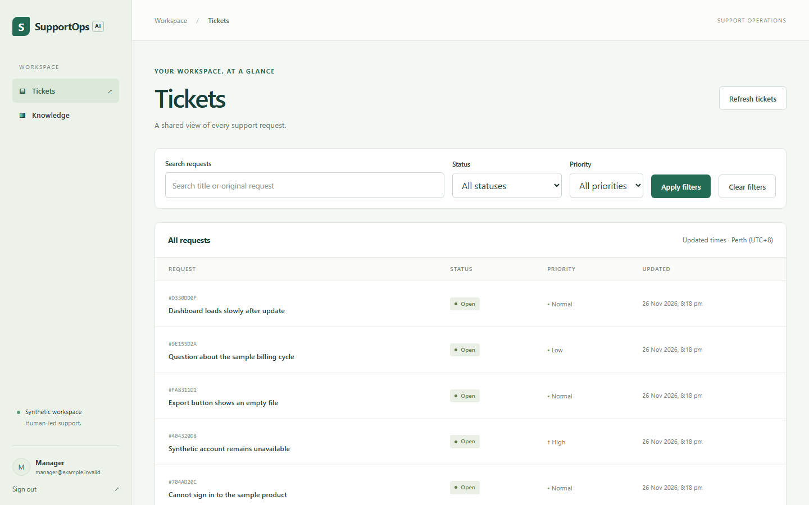
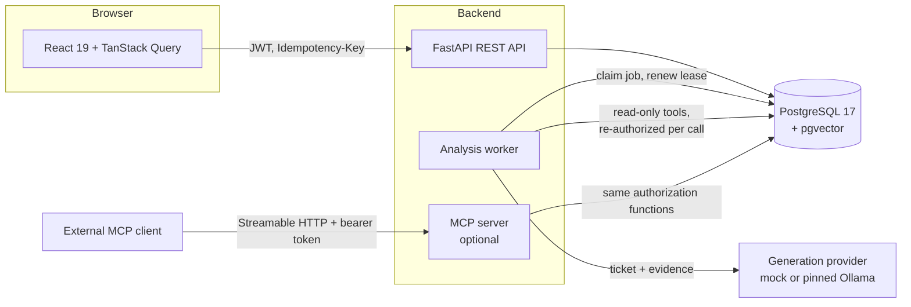

<div align="center">

# SupportOps AI

**An AI-assisted help desk where the model drafts, the server decides, and a person sends.**

[](https://github.com/Maxwell2048/supportops-ai/actions/workflows/ci.yml)     

[Quick start](#quick-start) · [Features](#features) · [How it works](#how-it-works) · [Documentation](#documentation) · [Roadmap](#roadmap)

</div>



SupportOps AI is a full-stack ticket and knowledge platform for a fictional software support team. Customers open tickets, agents work the ones assigned to them, and managers run the team and curate a versioned knowledge base. When an agent asks for help, a background worker lets a language model look things up through read-only tools and draft a reply that quotes its sources. Nothing reaches the customer until a staff member approves, edits or rejects the draft.

> [!NOTE]
> This is a portfolio project. It uses synthetic data only and runs locally (Docker Compose). The default model is a deterministic mock; a pinned local Ollama model is optional. Cloud deployment has not started. See [what is verified](#roadmap) before relying on any claim.

## Why this project

AI features in support tools fail in predictable ways. The model invents a source, reads another customer's ticket, or sends a reply nobody checked. SupportOps AI is built around one rule that addresses all three: **the model only proposes; the server decides; a person sends.**

- **Grounded drafts.** Every citation must be an exact, contiguous quote from published knowledge the agent may read. A draft without evidence can only be rejected.
- **Authorization the model cannot bypass.** Tool calls go through the same role and object checks as the REST API, re-checked on every call.
- **A human in the loop, atomically.** Approving a draft posts the reply, bumps the ticket version, and writes events and audit records in one transaction.

## Features

### Ticket workflow for three roles

| Requester | Agent | Manager |
|---|---|---|
| Create tickets with an optional contact phone | See only the tickets assigned to them | See and filter every ticket |
| Follow public replies on their own tickets | Reply publicly or add internal notes | Assign agents, change status, priority and archive state |
| Reopen a resolved ticket with a reason | Run AI analysis and review drafts | Query the audit trail |

Every write carries an `Idempotency-Key` and the ticket version it was based on. Retries after a lost response return the original result. Two people editing the same ticket get a `409` conflict, with their draft kept for review.

### AI drafts you can audit


- **Read-only tool loop.** The model may call `search_knowledge` and `ticket_history`, at most 3 rounds and 4 calls. The server checks each call against an allow-list and strict arguments, then re-authorizes the agent and ticket before running it. Reviewers see every call. ([tool use](docs/agent-tools.md))
- **Citation checks.** Quotes are verified against the stored knowledge chunk, and re-verified when the draft is read and again when it is sent. ([citations](docs/citations.md))
- **Human review.** Approve, send an edited reply, or reject. Review requests are idempotent and safe to replay. ([review](docs/review.md))
- **Provider provenance.** Each draft records which provider and model produced it. The default provider is a deterministic mock; a local Ollama model can be pinned by digest. ([generation](docs/generation.md))
- **Optional LangGraph orchestration** of the same loop, kept behind the same server-side checks. ([LangGraph](docs/langgraph-tool-loop.md))

### Versioned knowledge base


Managers write drafts, index them, then publish or archive. Published versions are immutable; publishing moves a pointer, so old citations always resolve to the exact text they quoted. Retrieval filters by the reader's permissions before ranking, with keyword search and optional pgvector embeddings. ([knowledge](docs/knowledge.md), [retrieval](docs/retrieval.md))

### Read-only MCP server

External MCP clients such as Claude Code can list and read the caller's tickets, public ticket history and permitted knowledge. The server reuses the API's JWT validation and authorization functions and writes one audit row per call. It is a separate process and is off by default. ([MCP](docs/mcp.md))

### Engineering details

- **Authorization in SQL.** Ticket queries start from a role-scoped base query. Objects outside the caller's scope return `404`, so their existence is not revealed. ([permissions](docs/permissions.md))
- **Durable job queue in PostgreSQL.** Workers claim jobs with `FOR UPDATE SKIP LOCKED`, hold a renewable lease, and retry transient failures. ([jobs](docs/jobs.md))
- **Transactional audit.** Successful writes and their audit rows commit together; every response carries a request ID. ([audit](docs/audit.md))
- **Session-scoped frontend cache.** TanStack Query keys include the session and role, so one user never sees another user's cached data. ([query cache](docs/query-cache.md))

## How it works



What happens when an agent clicks **Run analysis**:

1. The API records a job for the current ticket version and returns `202 Accepted`.
2. A worker claims the job with a lease. It runs the tool loop, re-checking the agent's access before each tool call.
3. The model drafts a reply from the collected evidence. The worker verifies every citation before saving the suggestion.
4. The agent reviews the draft. Approval posts the reply, records events and audit, and marks the job reviewed in one transaction.

## Quick start

**Prerequisites:** Git, Docker Desktop (or Docker Engine with Compose v2) and PowerShell 7. On macOS or Linux, use the equivalent shell commands.

```powershell
git clone https://github.com/Maxwell2048/supportops-ai.git
cd supportops-ai
Copy-Item .env.example .env
```

Edit `.env` and set `POSTGRES_PASSWORD` and `JWT_SECRET` (a random value of at least 32 bytes). Then start the stack, which contains PostgreSQL, migrations, the API, the mock worker and the web app:

```powershell
docker compose -f compose.full.yaml up --build -d --wait
```

Activate the five synthetic demo accounts with a password of your choice (12 or more characters):

```powershell
$env:DEMO_PASSWORD = Read-Host 'Demo password'
docker compose -f compose.full.yaml exec -T -e DEMO_PASSWORD api python -m supportops.compose_demo
```

Open <http://127.0.0.1:8080> and sign in with that password:

| Account | Role |
|---|---|
| `requester-a@example.invalid`, `requester-b@example.invalid` | Requester |
| `agent-a@example.invalid`, `agent-b@example.invalid` | Agent |
| `manager@example.invalid` | Manager |

**Try the AI flow:** as the manager, create a knowledge article, index it and publish it, then assign a ticket to `agent-a`. Sign in as `agent-a`, open the ticket and click **Run analysis**. When the ticket title matches the article's words, the draft cites it.

Stop the stack with `docker compose -f compose.full.yaml down`; the database volume is kept. Backup, restore and port settings are covered in the [Compose guide](docs/compose.md).

<details>
<summary><b>Manual development setup (hot reload)</b></summary>

Requires Python 3.14 with [uv](https://docs.astral.sh/uv/) and Node 22. Create `.env` from `.env.example` and set `POSTGRES_PASSWORD`. Start only the database container, then run each service from its own terminal.

```powershell
docker compose up -d db

# backend/
uv sync --locked
uv run --locked alembic upgrade head
uv run --locked python ../scripts/seed.py
uv run --locked python ../scripts/configure_local_auth.py   # adds JWT_SECRET and DEMO_PASSWORD to .env if missing
uv run --locked python ../scripts/activate_demo_accounts.py
uv run --locked uvicorn supportops.main:app --app-dir src --host 127.0.0.1 --port 8000

# backend/ (second terminal): the analysis worker
$env:PYTHONPATH = 'src'
uv run --locked python -m supportops.job_worker

# frontend/
npm ci
npm run dev
```

Vite serves the app on <http://127.0.0.1:5173> and proxies `/api` to port 8000. API docs are at <http://127.0.0.1:8000/docs>. Optional: import the bundled synthetic knowledge with `uv run --locked python ../scripts/seed_knowledge.py --publish`.

Details: [database](docs/database.md), [authentication](docs/auth.md), [frontend](docs/frontend.md), [worker and local models](docs/jobs.md). On Windows, `scripts/start-docker.ps1` starts Docker Desktop if the engine is not running.

</details>

## Testing

```powershell
# backend/ (uses a dedicated PostgreSQL test database; see docs/database.md)
uv run --locked python ../scripts/test_backend.py -q

# frontend/
npm run build
npm run test:api; npm run test:query; npm run test:writes; npm run test:components; npm run test:types
npm run test:e2e
```

GitHub Actions runs three jobs on every push: **api** (backend suite on PostgreSQL), **web** (build, unit and component tests, Playwright end-to-end tests), and **stack** (Compose stack, a scripted business flow, backup and restore with per-table fingerprints). The latest run on `main` passed 421 backend tests with no skips, 53 frontend unit and component tests, and 24 end-to-end tests. See the [testing guide](docs/testing.md).

## Tech stack

| Layer | Technology |
|---|---|
| Frontend | React 19, TypeScript 7, Vite 8, TanStack Query 5 |
| Backend | Python 3.14, FastAPI, SQLAlchemy 2.1, Alembic, Pydantic, PyJWT, Argon2 |
| Data | PostgreSQL 17, pgvector, full-text search |
| AI | Provider interface with a deterministic mock and pinned Ollama models; optional LangGraph; MCP Python SDK |
| Testing | pytest, Node test runner, Vitest, Testing Library, Playwright |
| Delivery | Docker Compose, Nginx, GitHub Actions, uv and npm lockfiles |

## Project structure

```text
supportops-ai/
├── backend/
│   ├── src/supportops/     # API routes, services, worker, tool loop, MCP server
│   ├── migrations/         # Alembic migrations 0001–0011
│   └── tests/              # unit and PostgreSQL integration tests
├── frontend/
│   ├── src/                # React pages, components, API client, query state
│   └── tests/              # API-client, query and write tests; component tests
├── data/                   # synthetic seed knowledge
├── evals/                  # retrieval evaluation cases
├── scripts/                # setup, verification, backup and test helpers
├── docs/                   # guides, ADRs and dated verification evidence
├── compose.yaml            # database only, for development
└── compose.full.yaml       # full local stack
```

## Documentation

| Topic | Guides |
|---|---|
| Product and design | [Project brief](docs/planning/project-brief.md) · [Architecture](docs/architecture.md) · [Permissions](docs/permissions.md) · [State transitions](docs/state-transitions.md) · [Data model](docs/data-model.md) · [API contract](docs/api.md) |
| Tickets and security | [Authentication](docs/auth.md) · [Tickets, idempotency and pagination](docs/tickets.md) · [Audit](docs/audit.md) · [Forms and safe retries](docs/forms.md) |
| Knowledge and AI | [Knowledge](docs/knowledge.md) · [Retrieval](docs/retrieval.md) · [Generation](docs/generation.md) · [Jobs](docs/jobs.md) · [Tool use](docs/agent-tools.md) · [Citations](docs/citations.md) · [Review](docs/review.md) · [LangGraph](docs/langgraph-tool-loop.md) · [MCP](docs/mcp.md) |
| Frontend | [Frontend](docs/frontend.md) · [Query cache](docs/query-cache.md) |
| Operations and quality | [Database](docs/database.md) · [Compose and recovery](docs/compose.md) · [Testing](docs/testing.md) · [Delivery handbook](docs/handbook.md) |
| Decisions and history | [Architecture decision records](docs/adr/) · [Progress and evidence](docs/progress.md) · [Git workflow](docs/git-workflow.md) |

## Roadmap

| Milestone | Scope | Status |
|---|---|---|
| M0 | Roles, states, data model, API and data policy | Drafted |
| M1 | Database, authentication, ticket API, audit | Verified locally |
| M2 | React app, caching, forms, component and end-to-end tests | Verified locally and in CI |
| M3 | Knowledge versions, retrieval, AI jobs, citations, human review, tool use, MCP | Verified with the mock provider; real-model evaluation is limited |
| M4 | SQL and AI evaluation, Compose, backup and restore, CI | Compose, restore and CI verified; broader evaluation open |
| M5 | Azure, infrastructure as code, observability, release rollback | Deferred |

"Implemented" and "verified" are tracked separately. Every verified claim links to a dated evidence record in [progress](docs/progress.md).

**Known limits:** keyword retrieval needs every query term to match; real models were only smoke-tested; the knowledge base has four synthetic articles; the MCP server is local-only and was not tried with a real client.

## Contributing

This is a personal portfolio project, but issues and suggestions are welcome. When contributing:

- Use only synthetic or explicitly licensed data, and never commit secrets or a real `.env`.
- Write repository content in English, and run `python scripts/check_repository_language.py`.
- Keep `uv.lock` and `package-lock.json` in sync with dependency changes.
- Enforce authorization on the server, and treat model output and retrieved text as untrusted.

See [AGENTS.md](AGENTS.md) and the [Git workflow](docs/git-workflow.md) for the full conventions.

## License

No license file has been added yet.
