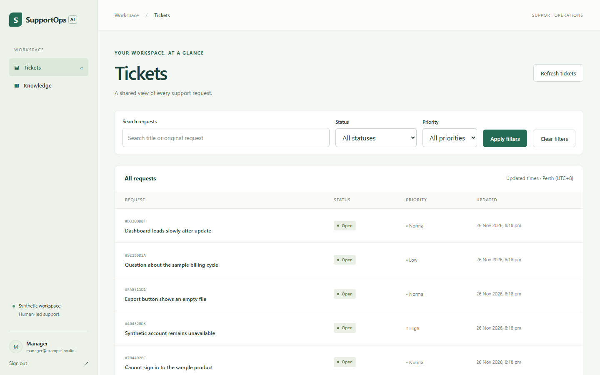
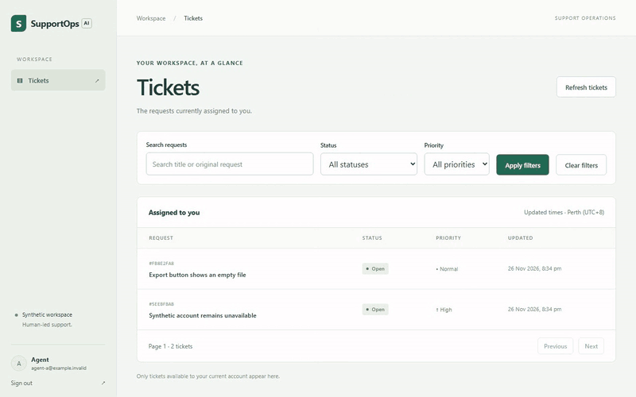
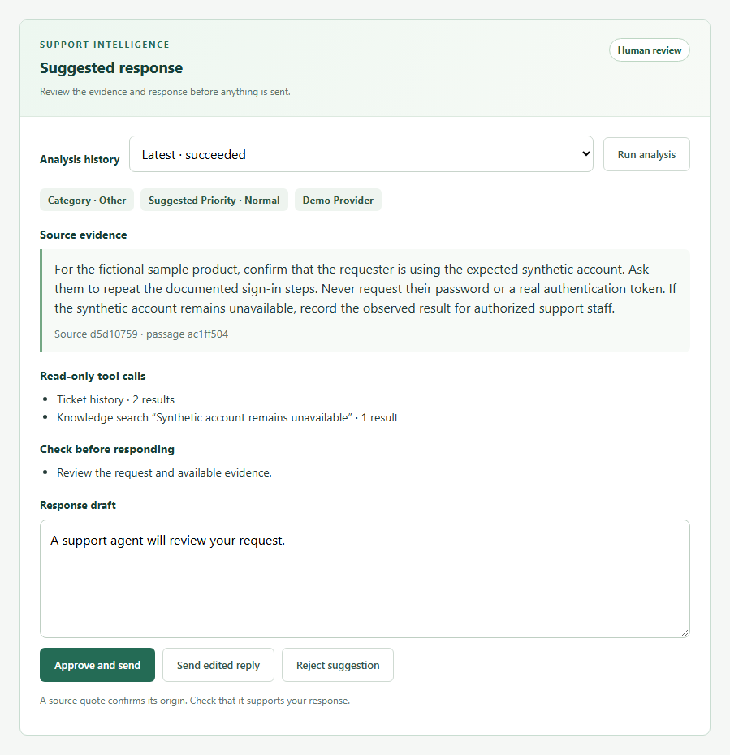
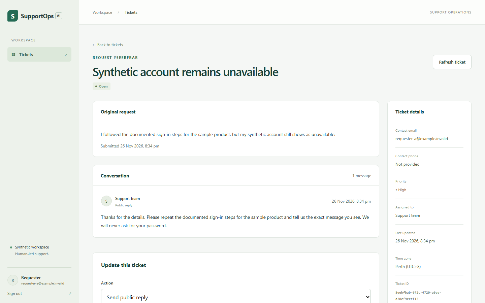
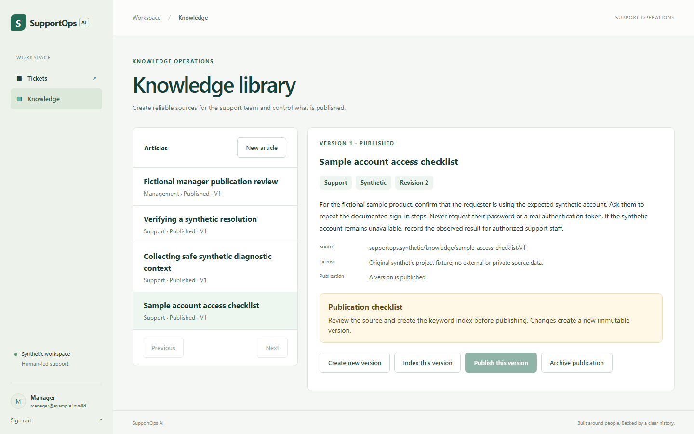
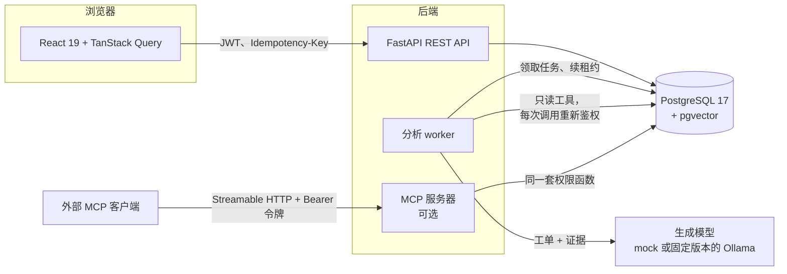
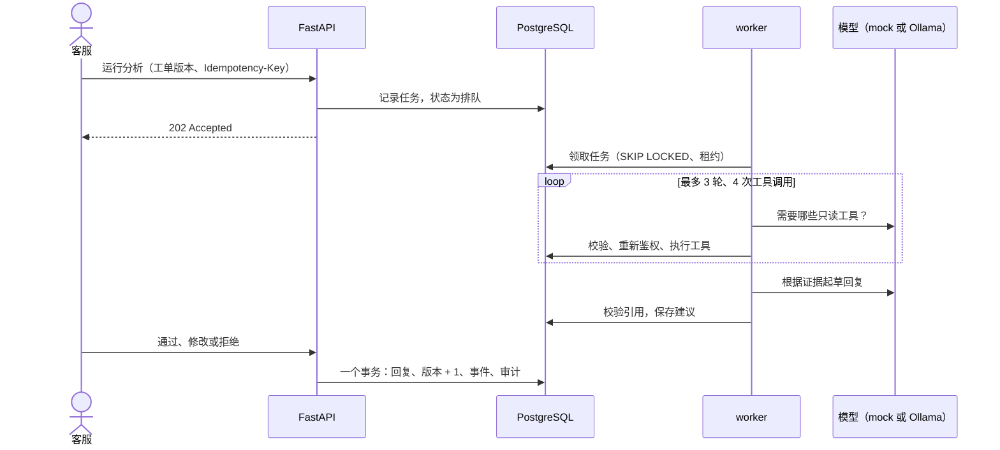
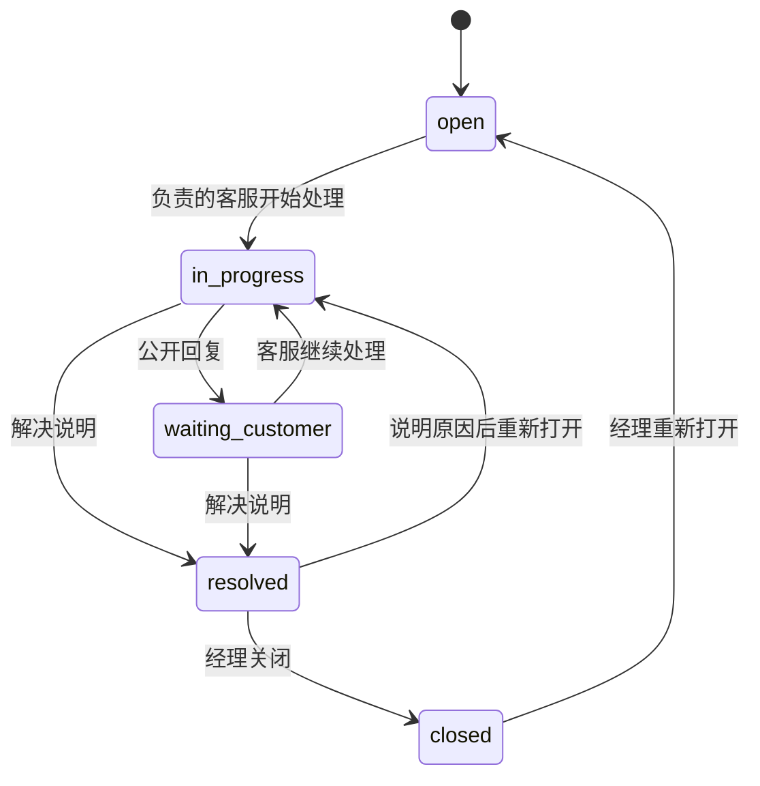

<div align="center">

# SupportOps AI

**一个由 AI 辅助的客服工单系统：模型起草，服务器把关，人来发送。**

[](README.md)
[](README.zh-CN.md)

[](https://github.com/Maxwell2048/supportops-ai/actions/workflows/ci.yml) [](LICENSE)      

[演示](#演示) · [功能](#功能) · [工作原理](#工作原理) · [快速开始](#快速开始) · [文档](#文档) · [常见问题](#常见问题)

</div>



SupportOps AI 是一个全栈的工单与知识库平台，服务对象是一个虚构软件公司的客服团队。客户提交工单，客服处理分配给自己的工单，经理管理团队并维护带版本的知识库。客服需要帮助时，后台 worker 让大模型通过只读工具查资料，起草一份引用原文的回复。**在客服通过、修改或拒绝之前，任何内容都不会发给客户。**

> [!NOTE]
> 这是一个作品集项目。只使用合成数据，用 Docker Compose 在本地运行。默认模型是确定性的 mock，也可以选用固定版本的本地 Ollama 模型。还没有部署到云端。哪些内容经过验证，见[路线图](#路线图)。

> 本文是 [README.md](README.md) 的中文翻译。两者不一致时，以英文版为准。

<details>
<summary><b>目录</b></summary>

- [演示](#演示)
- [为什么做这个项目](#为什么做这个项目)
- [亮点](#亮点)
- [功能](#功能)
- [截图](#截图)
- [工作原理](#工作原理)
- [数据一览](#数据一览)
- [快速开始](#快速开始)
- [配置](#配置)
- [接口一览](#接口一览)
- [连接 MCP 客户端](#连接-mcp-客户端)
- [测试](#测试)
- [技术栈](#技术栈)
- [目录结构](#目录结构)
- [文档](#文档)
- [路线图](#路线图)
- [常见问题](#常见问题)
- [参与贡献](#参与贡献)
- [许可证](#许可证)

</details>

## 演示

客服打开分配给自己的工单，运行分析，核对引用的原文和工具调用记录，改写草稿后发送，回复随即出现在对话里。



<sub>录制自本地栈，使用合成数据和默认的 mock 模型，所以草稿的原始文字是固定的占位内容。</sub>

## 为什么做这个项目

客服工具里的 AI 功能，出问题的方式往往很固定：模型编造来源、读到别的客户的工单、发出没人检查过的回复。SupportOps AI 围绕一条规则设计，同时解决这三个问题：**模型只提议，服务器决定，人来发送。**

| 风险 | SupportOps AI 的做法 |
|---|---|
| 编造来源 | 每条引用都必须是客服有权阅读的已发布知识里一段完整、连续的原文。没有证据的草稿只能被拒绝。 |
| 数据在客户之间泄露 | 工具调用和 REST API 走同一套角色和对象权限检查，而且每次调用都重新检查。 |
| 回复未经检查 | 由人通过、修改或拒绝。通过时，发送回复、工单版本加一、写入事件和审计记录在同一个事务里完成。 |

## 亮点

<table>
<tr>
<td width="33%" valign="top">

**🔎 有据可查的草稿**<br>
引用在草稿保存、读取、发送时各核对一次，必须和存储的知识片段一致。

</td>
<td width="33%" valign="top">

**🛡️ 服务器把关**<br>
白名单、严格参数、最多 3 轮 4 次调用，约束模型对工具的使用。

</td>
<td width="33%" valign="top">

**🧑‍💼 人工审核**<br>
通过、修改或拒绝；审核请求幂等，可以安全重试。

</td>
</tr>
<tr>
<td valign="top">

**📚 带版本的知识库**<br>
不可变版本、发布指针，以及按权限过滤的关键词和向量检索。

</td>
<td valign="top">

**🔌 MCP 服务器**<br>
外部 MCP 客户端用 API 自己的权限规则读取工单和知识，每次调用写一行审计。

</td>
<td valign="top">

**🧪 不只是做出来，还验证过**<br>
CI 里运行 421 个后端测试、53 个前端测试和 24 个端到端测试，每条结论都有带日期的证据记录。

</td>
</tr>
</table>

## 功能

### 三种角色的工单流程

| 客户（Requester） | 客服（Agent） | 经理（Manager） |
|---|---|---|
| 提交工单，可选填联系电话 | 只能看到分配给自己的工单 | 查看和筛选所有工单 |
| 查看自己工单的公开回复 | 发公开回复或内部备注 | 分配客服；修改状态、优先级、归档 |
| 对已解决的工单说明原因后重新打开 | 运行 AI 分析并审核草稿 | 维护知识库，查询审计记录 |

每次写操作都带 `Idempotency-Key` 和它所基于的工单版本。响应丢失后重试，会拿到原来的结果。两个人同时改同一张工单，后提交的人收到 `409` 冲突，他写的草稿会保留下来供核对。

### 可以审计的 AI 草稿

- **只读工具循环。** 模型可以调用 `search_knowledge` 和 `ticket_history`。服务器先用白名单和严格参数检查每次调用，再重新确认客服和工单的权限，然后才执行。审核人能看到每一次调用。（[工具调用](docs/agent-tools.md)）
- **引用校验。** 引用原文要和存储的知识片段一致，读取草稿和发送时还会再校验。（[引用](docs/citations.md)）
- **人工审核。** 通过、发送修改后的回复，或拒绝。（[审核](docs/review.md)）
- **模型来源记录。** 每份草稿都记录生成它的提供方和模型。本地 Ollama 模型可以按 digest 固定版本。（[生成](docs/generation.md)）
- **可选的 LangGraph 编排**，同一个循环，同样由服务器把关。（[LangGraph](docs/langgraph-tool-loop.md)）

### 带版本的知识库

经理写草稿、建索引，然后发布或归档。已发布的版本不可修改；发布只是移动一个指针，所以旧引用永远能找回当时引用的原文。检索先按读者权限过滤，再排序。（[知识库](docs/knowledge.md)、[检索](docs/retrieval.md)）

### 只读 MCP 服务器

Claude Code 这类外部 MCP 客户端可以列出和读取调用者的工单、工单的公开历史和有权阅读的知识。服务器复用 API 的 JWT 校验和权限函数，每次调用写一行审计。它是单独的进程，默认不启动。（[MCP](docs/mcp.md)）

### 工程细节

- **权限写在 SQL 里。** 工单查询从按角色限定范围的基础查询开始。超出调用者范围的对象返回 `404`，不暴露它是否存在。（[权限](docs/permissions.md)）
- **PostgreSQL 里的持久任务队列。** worker 用 `FOR UPDATE SKIP LOCKED` 领取任务，持有可续期的租约，临时失败会重试。（[任务](docs/jobs.md)）
- **事务内审计。** 成功的写操作和它的审计记录一起提交；每个响应都带 request ID。（[审计](docs/audit.md)）
- **按会话隔离的前端缓存。** TanStack Query 的缓存键包含会话和角色，一个用户永远看不到另一个用户的缓存数据。（[查询缓存](docs/query-cache.md)）

## 截图

<table>
<tr>
<td width="50%"><br><sub><b>客服：</b>建议回复，附引用原文、工具调用记录和审核操作</sub></td>
<td width="50%"><br><sub><b>客户：</b>发出的回复显示为公开消息；内部备注和草稿不可见</sub></td>
</tr>
<tr>
<td width="50%"><br><sub><b>经理：</b>知识库，包含版本、适用范围、来源和发布操作</sub></td>
<td width="50%"><br><sub><b>经理：</b>全部工单，可按关键词、状态和优先级筛选</sub></td>
</tr>
</table>

## 工作原理

### 架构



### 从“运行分析”到发出回复



### 工单状态



不在图中的状态变化返回 `409 invalid_transition`。经理可以归档已关闭的工单。详见[状态流转](docs/state-transitions.md)。

## 数据一览

| 项目 | 数量 |
|---|---|
| 各有独立视图和权限的角色 | 3 |
| 数据库表 / Alembic 迁移 | 15 / 11 |
| 架构决策记录（ADR） | 12 |
| 后端测试（PostgreSQL，无跳过） | 421 |
| 前端单元和组件测试 | 53 |
| Playwright 端到端测试（桌面和窄屏） | 24 |
| 只读 MCP 工具 | 4 |

测试数量来自 `main` 分支最近一次 CI 运行。

## 快速开始

**前提：** Git、Docker Desktop（或带 Compose v2 的 Docker Engine）和 PowerShell 7。macOS 或 Linux 上用对应的 shell 命令。

```powershell
git clone https://github.com/Maxwell2048/supportops-ai.git
cd supportops-ai
Copy-Item .env.example .env
```

编辑 `.env`，设置 `POSTGRES_PASSWORD` 和 `JWT_SECRET`（至少 32 字节的随机值）。然后启动整套服务，包括 PostgreSQL、迁移、API、mock worker 和前端：

```powershell
docker compose -f compose.full.yaml up --build -d --wait
```

自己选一个密码（至少 12 个字符），激活五个合成演示账号：

```powershell
$env:DEMO_PASSWORD = Read-Host 'Demo password'
docker compose -f compose.full.yaml exec -T -e DEMO_PASSWORD api python -m supportops.compose_demo
```

打开 <http://127.0.0.1:8080>，用这个密码登录：

| 账号 | 角色 |
|---|---|
| `requester-a@example.invalid`、`requester-b@example.invalid` | 客户 |
| `agent-a@example.invalid`、`agent-b@example.invalid` | 客服 |
| `manager@example.invalid` | 经理 |

**体验 AI 流程**

1. 用经理账号打开 **Knowledge**，新建一篇文章，建索引并发布。
2. 把一张工单分配给 `agent-a`。
3. 用 `agent-a` 登录，打开这张工单，点 **Run analysis**。工单标题里的词在文章中都能找到时，草稿就会引用这篇文章。
4. 通过、修改或拒绝草稿，再用客户账号登录查看回复。

用 `docker compose -f compose.full.yaml down` 停止，数据库卷会保留。备份、恢复和端口设置见 [Compose 指南](docs/compose.md)。

<details>
<summary><b>手动搭建开发环境（支持热更新）</b></summary>

需要 Python 3.14（配 [uv](https://docs.astral.sh/uv/)）和 Node 22。从 `.env.example` 复制出 `.env` 并设置 `POSTGRES_PASSWORD`。只启动数据库容器，其余服务各开一个终端运行。

```powershell
docker compose up -d db

# backend/
uv sync --locked
uv run --locked alembic upgrade head
uv run --locked python ../scripts/seed.py
uv run --locked python ../scripts/configure_local_auth.py   # .env 里缺少时补上 JWT_SECRET 和 DEMO_PASSWORD
uv run --locked python ../scripts/activate_demo_accounts.py
uv run --locked uvicorn supportops.main:app --app-dir src --host 127.0.0.1 --port 8000

# backend/（第二个终端）：分析 worker
$env:PYTHONPATH = 'src'
uv run --locked python -m supportops.job_worker

# frontend/
npm ci
npm run dev
```

Vite 在 <http://127.0.0.1:5173> 提供页面，并把 `/api` 转发到 8000 端口。API 文档在 <http://127.0.0.1:8000/docs>。可选：用 `uv run --locked python ../scripts/seed_knowledge.py --publish` 导入自带的合成知识。

详见：[数据库](docs/database.md)、[认证](docs/auth.md)、[前端](docs/frontend.md)、[worker 和本地模型](docs/jobs.md)。在 Windows 上，如果 Docker 引擎没有运行，`scripts/start-docker.ps1` 会启动 Docker Desktop。

</details>

## 配置

配置放在 `.env` 里（从 [`.env.example`](.env.example) 复制，不要提交）。

| 变量 | 用途 | 默认值 |
|---|---|---|
| `POSTGRES_DB`、`POSTGRES_USER`、`POSTGRES_PASSWORD` | 数据库名和账号密码 | `supportops` / `supportops` / 必填 |
| `POSTGRES_HOST`、`POSTGRES_PORT` | 本地运行时的数据库地址 | `127.0.0.1`、`5432` |
| `JWT_SECRET` | 令牌签名密钥，至少 32 字节；为空则无法登录 | 必填 |
| `JWT_ISSUER`、`JWT_AUDIENCE` | 令牌签发方和受众校验 | `supportops-api`、`supportops-web` |
| `ACCESS_TOKEN_MINUTES` | 访问令牌有效期，1 到 30 分钟 | `15` |
| `DEMO_PASSWORD` | 激活合成账号时使用的密码 | 无 |
| `AI_PROVIDER` | 生成模型提供方 | `mock` |
| `EMBEDDING_URL` | 生成向量用的本地 Ollama 地址 | `http://127.0.0.1:11434` |
| `ANALYSIS_LOOP` | 工具循环的编排方式：`handwritten` 或 `langgraph` | `handwritten` |
| `SUPPORTOPS_WEB_PORT` | Compose 前端在本机的端口 | `8080` |

## 接口一览

完整约定见 [docs/api.md](docs/api.md)，也可以打开 `/docs` 查看交互式 OpenAPI 页面。

| 方法和路径 | 用途 |
|---|---|
| `POST /api/auth/login` · `GET /api/me` | 登录、读取当前身份 |
| `GET /api/tickets` · `POST /api/tickets` | 列出工单（按权限限定范围、可筛选、游标分页）、创建工单 |
| `GET /api/tickets/{id}` · `PATCH /api/tickets/{id}` | 读取和修改工单（状态、处理人、优先级、归档） |
| `POST /api/tickets/{id}/messages` | 公开回复或内部备注 |
| `POST /api/tickets/{id}/analysis-jobs` | 发起 AI 分析任务 |
| `GET /api/analysis-jobs/{id}/suggestion` | 读取建议、证据和工具调用 |
| `POST /api/suggestions/{id}/review` | 通过、修改或拒绝建议 |
| `GET /api/knowledge/search` | 按权限过滤的关键词或向量检索 |
| `POST /api/knowledge/articles/{id}/publish` | 发布一个知识版本 |
| `GET /api/audit-events` | 经理查询审计记录 |
| `GET /health` · `GET /ready` | 存活检查和就绪检查（数据库、迁移版本、认证配置） |

## 连接 MCP 客户端

把 MCP 服务器作为单独的进程启动，再用 `POST /api/auth/login` 拿到的短期访问令牌配置客户端：

```powershell
# backend/
uv run --locked uvicorn supportops.mcp_server:create_mcp_app --factory --app-dir src --host 127.0.0.1 --port 8001
```

```json
{
  "mcpServers": {
    "supportops": {
      "type": "http",
      "url": "http://127.0.0.1:8001/mcp",
      "headers": { "Authorization": "Bearer ${SUPPORTOPS_ACCESS_TOKEN}" }
    }
  }
}
```

工具有 `list_my_tickets`、`get_ticket`、`ticket_history` 和 `search_knowledge`，只对客服和经理开放。这份配置还没有用真实的 Claude 客户端试过，详见 [MCP 指南](docs/mcp.md)。

## 测试

```powershell
# backend/（使用专门的 PostgreSQL 测试库，见 docs/database.md）
uv run --locked python ../scripts/test_backend.py -q

# frontend/
npm run build
npm run test:api; npm run test:query; npm run test:writes; npm run test:components; npm run test:types
npm run test:e2e
```

每次 push 和 pull request，GitHub Actions 运行三个 job：

| Job | 检查内容 |
|---|---|
| `api` | 在带 pgvector 的 PostgreSQL 上跑后端测试 |
| `web` | 类型检查和构建、单元和组件测试、Playwright 端到端测试 |
| `stack` | 启动完整的 Compose 栈，跑一遍脚本化业务流程，再备份、恢复并逐表比对指纹 |

详见[测试指南](docs/testing.md)。

## 技术栈

| 层 | 技术 |
|---|---|
| 前端 | React 19、TypeScript 7、Vite 8、TanStack Query 5 |
| 后端 | Python 3.14、FastAPI、SQLAlchemy 2.1、Alembic、Pydantic、PyJWT、Argon2 |
| 数据 | PostgreSQL 17、pgvector、全文检索 |
| AI | 模型提供方接口，内置确定性 mock 和固定版本的 Ollama 模型；可选 LangGraph；MCP Python SDK |
| 测试 | pytest、Node 测试运行器、Vitest、Testing Library、Playwright |
| 交付 | Docker Compose、Nginx、GitHub Actions、uv 和 npm 锁文件 |

## 目录结构

```text
supportops-ai/
├── backend/
│   ├── src/supportops/     # API 路由、业务服务、worker、工具循环、MCP 服务器
│   ├── migrations/         # Alembic 迁移 0001–0011
│   └── tests/              # 单元测试和 PostgreSQL 集成测试
├── frontend/
│   ├── src/                # React 页面、组件、API 客户端、查询状态
│   └── tests/              # API 客户端、查询和写操作测试；组件测试
├── data/                   # 合成的种子知识
├── evals/                  # 检索评估用例
├── scripts/                # 搭建、验证、备份和测试辅助脚本
├── docs/                   # 指南、ADR 和带日期的验证记录
├── compose.yaml            # 只含数据库，开发时用
└── compose.full.yaml       # 完整的本地栈
```

## 文档

文档都是英文。

| 主题 | 指南 |
|---|---|
| 产品与设计 | [项目需求](docs/planning/project-brief.md) · [架构](docs/architecture.md) · [权限](docs/permissions.md) · [状态流转](docs/state-transitions.md) · [数据模型](docs/data-model.md) · [API 约定](docs/api.md) |
| 工单与安全 | [认证](docs/auth.md) · [工单、幂等与分页](docs/tickets.md) · [审计](docs/audit.md) · [表单与安全重试](docs/forms.md) |
| 知识与 AI | [知识库](docs/knowledge.md) · [检索](docs/retrieval.md) · [生成](docs/generation.md) · [任务](docs/jobs.md) · [工具调用](docs/agent-tools.md) · [引用](docs/citations.md) · [审核](docs/review.md) · [LangGraph](docs/langgraph-tool-loop.md) · [MCP](docs/mcp.md) |
| 前端 | [前端](docs/frontend.md) · [查询缓存](docs/query-cache.md) |
| 运维与质量 | [数据库](docs/database.md) · [Compose 与恢复](docs/compose.md) · [测试](docs/testing.md) · [交付手册](docs/handbook.md) |
| 决策与历史 | [架构决策记录](docs/adr/) · [进度与证据](docs/progress.md) · [Git 工作流](docs/git-workflow.md) |

## 路线图

| 里程碑 | 范围 | 状态 |
|---|---|---|
| M0 | 角色、状态、数据模型、API 和数据策略 | ✅ 已起草 |
| M1 | 数据库、认证、工单 API、审计 | ✅ 本地已验证 |
| M2 | React 应用、缓存、表单、组件和端到端测试 | ✅ 本地和 CI 已验证 |
| M3 | 知识版本、检索、AI 任务、引用、人工审核、工具调用、MCP | ✅ 用 mock 模型验证；🔶 真实模型评估有限 |
| M4 | SQL 和 AI 评估、Compose、备份恢复、CI | ✅ Compose、恢复和 CI；🔶 更全面的评估未完成 |
| M5 | Azure、基础设施即代码、可观测性、发布回滚 | ⏸️ 暂缓 |

“已实现”和“已验证”分开记录；每条已验证的结论都在[进度文档](docs/progress.md)里链接到带日期的证据记录。

**已知局限：** 关键词检索要求查询里的每个词都命中；真实模型只做过冒烟测试；知识库只有四篇合成文章；MCP 服务器只能在本机使用；在手机的窄屏上，工单表格比屏幕宽。

## 常见问题

<details>
<summary><b>AI 能自己发回复或关闭工单吗？</b></summary>

不能。worker 只能保存一份建议，必须由客服通过、修改或拒绝，只有通过或发送修改后的回复才会产生公开消息。没有任何 AI 路径会改变工单状态。

</details>

<details>
<summary><b>需要 GPU 或 API Key 吗？</b></summary>

不需要。默认模型是确定性的 mock，整个流程在任何装了 Docker 的机器上都能跑。本地 Ollama 模型是可选的，并且必须按 digest 固定版本。

</details>

<details>
<summary><b>怎么防止模型读到别的客户的工单？</b></summary>

每次工具调用都在自己的事务里，用和 REST API 相同的函数，重新检查客服的角色和工单当前的分配情况。超出客服范围的工单一律返回“不存在”。

</details>

<details>
<summary><b>包含真实的客户数据吗？</b></summary>

不包含。账号使用保留域名 `example.invalid`，工单和知识都是为本项目编写的合成数据。

</details>

## 参与贡献

这是个人作品集项目，但欢迎提 issue 和建议。参与时请注意：

- 只使用合成数据或明确获得授权的数据，不要提交密钥或真实的 `.env`。
- 仓库内容用英文书写（本中文 README 是唯一例外），并运行 `python scripts/check_repository_language.py`。
- 依赖有变化时，同步更新 `uv.lock` 和 `package-lock.json`。
- 权限一律在服务器端检查，把模型输出和检索到的文本都当作不可信数据。

完整约定见 [AGENTS.md](AGENTS.md) 和 [Git 工作流](docs/git-workflow.md)。

## 许可证

以 [MIT 许可证](LICENSE)发布。
