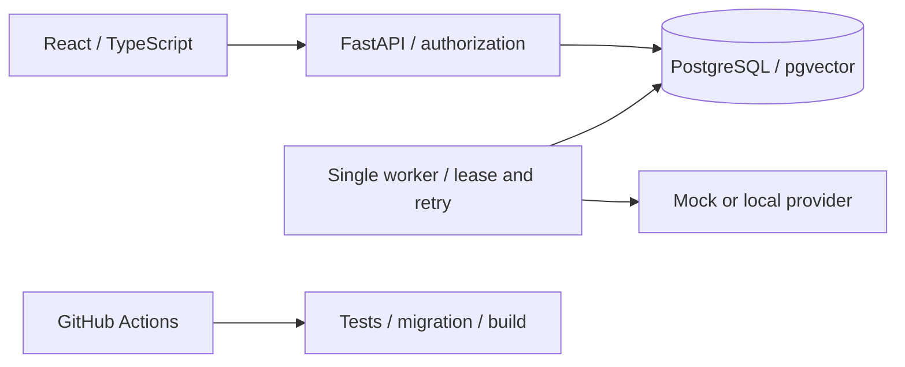

# Architecture baseline

S05-S08 database, authentication, ticket writes, transactional audit, and request logs are locally verified. S09-S10 add typed read-only pages and session-owned query/cache/filter/paging behavior; write forms and AI remain planned.

The diagram includes planned components. The frontend owns interactions and server-state caching; the backend exclusively decides identity, permissions, authorship, and business state. API and future worker share a database but run as separate processes. Validate all external inputs and model outputs.

| Directory | Responsibility | Status |
|---|---|---|
| backend/src/supportops | API, security, authorization, ticket transactions; future worker | Login, ticket reads/writes, events/idempotency, pagination, audit/logging |
| backend/tests | Authentication, authorization, business, concurrency, PostgreSQL | S08: 173 locally passing tests |
| backend/migrations | Alembic history | 0001 business tables, 0002 idempotency, 0003 audit; empty/existing DB upgrades verified |
| frontend/src | Typed client, sessions, React pages | S09-S10 pages, four-state feedback, cache/filter/paging locally verified |
| e2e | Cross-role browser workflows | Reserved for S12 |
| data | Synthetic data and sources | Minimal seed and explicit local activation verified |
| evals | Development/holdout data and evaluation | Reserved for S21 |
| infra | Bicep, cloud configuration, cleanup | Reserved for S24 |
| scripts | Configuration, seed, tests, HTTP checks | Runnable helpers; backup/recovery in S22 |
| docs/evidence | Actual execution records | Recorded by stage |
| analytics | Optional data-platform extensions | After the main track |

## Consistency boundaries

- Version-conditional updates reject stale writes with 409.
- Messages, status changes, events, idempotency results, and success audit commit together. Failures roll back completely and are traced through independent redacted request logs.
- Future jobs, suggestions, and review decisions persist in the database; API requests do not directly run inference.
- Public replies require an authorized human. Future AI publication rechecks permissions, ticket version, and knowledge availability.
- Store UTC timestamps; UI explicitly displays its timezone, initially Australia/Perth.

## Remaining work

Readiness requires migration 0003 and the JWT secret. Persistent failure logs, full business write UI, retrieval, worker, and deployment remain unimplemented. Compose currently runs only the database, not the complete application.
