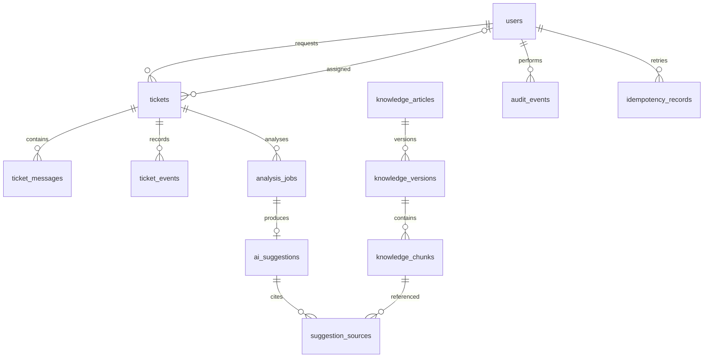

# Data model (S13: tickets, audit and immutable knowledge)

UUID primary keys, timestamptz timestamps, no bodies in logs. This field summary is not the migration source.

On 2026-10-22, users/tickets/ticket_messages/ticket_events/idempotency_records/audit_events are verified with real PostgreSQL 17.11. Other tables and message suggestion_id remain designs. Users default inactive. Ticket events keep before/after changes and one aggregate event/version. Services check current role/active/scope transactionally.

On 2026-10-27, S13 additionally verified knowledge_articles/knowledge_versions/knowledge_events under0004. Chunks, jobs, suggestions and suggestion_id remain designs. Knowledge revisions and immutable snapshot numbers are separate; see [current execution](evidence/2026-10-27-knowledge-versioning.md).

| Table | Core fields/constraints |
|---|---|
| users | unique email, password_hash, checked role, active |
| tickets | requester/nullable assignee FKs, title/body, checked status/priority, version>0, archived, timestamps |
| ticket_messages | ticket/author FKs, public/internal, body, timestamp; planned nullable unique suggestion_id FK, human author only |
| ticket_events | ticket/actor FKs, event_type, changes, ticket_version; unique(ticket,version), atomic with business write |
| knowledge_articles | Logical ID, creator FK, aggregate revision, latest version number, nullable current publication pointer, archive/timestamps; composite pointer FK enforces same article |
| knowledge_versions | Article FK, immutable UUID/number/title/body/scope/provenance/hash/creator/time; unique(article,number), composite article/id key; DML immutability trigger |
| knowledge_events | Article/version/actor FKs, manager role, action/result/request UUID, article revision and allowlisted metadata; unique(article,revision), append-only trigger |
| knowledge_chunks | Planned version FK, ordinal/text/hash, embedding model/dimension/vector; unique(version,ordinal) |
| analysis_jobs | Planned ticket/requester FKs, idempotency/hash/version, status/attempts/lease token/expiry/error/next-attempt |
| ai_suggestions | Planned unique job FK, category/priority/draft/checks/evidence/review, reviewer FK, model/prompt versions, reviewed_at |
| suggestion_sources | Planned suggestion/chunk/version FKs, quote/hash; contiguous original-text validation |
| audit_events | actor FK/role snapshot, resource_type=ticket, ticket resource FK, action/result=success, request UUID, version, allowlisted changes/time; unique(resource,version) |
| idempotency_records | actor FK, nonnull resource UUID, operation/key/hash, successful response status/body/time; unique(actor,resource,operation,key) |

Separate knowledge_versions distinguishes logical articles from immutable historical content. Generic idempotency supports current ticket and knowledge writes; future reviews/jobs retain their planned direct association.

## Transactions and indexes

- FKs prevent orphans. Disable accounts rather than deleting history; no cascading business-history deletes.
- S13 uses one publication pointer per article instead of the originally planned partial status index. Status is derived without modifying immutable version rows; [decision](adr/0009-immutable-knowledge-and-current-scope.md).
- Planned worker claim: atomic row locks/skip locked, verified in S16.
- Current access-path indexes include requester/created/id, assignee/status/created/id, message ticket/created/id, and audit created/id/resource/request. Planned jobs use status/next_attempt_at. S20 measures actual plans before claiming gains.
- Select embedding model/dimension in S14; do not assume shared indexes across dimensions.
- Stable UUIDs/fixed seed and synthetic-only records. Executed migration definitions determine real constraints.
